# Partner Dashboard refinement — final local acceptance

Status: accepted for the approved local refinement scope. Implementation and accuracy fixes were verified before the final screenshot capture. This is connected local acceptance with synthetic data, not hosted or production readiness. No push, PR, merge or deployment was performed.

## Overview

Preserved the existing tenant-scoped loaders, next event, calendar, upcoming events and network. The Tickets/Revenue graph uses smooth bounded cubic segments, restrained orange fill and a single baseline; actual point values and keyboard interaction remain. Recent orders use compact separator rows. Only supported order activity is shown; no invented refunds, payouts or bookings were added. Host accent is consistently C1RCLE orange. The sidebar implementation, destinations and ordering are unchanged.

## Events Analytics

All Events and Analytics remain inside Events. Connected sources are the existing organization overview, sales breakdown and trends endpoints plus the new read-only `/api/v2/organizations/:organizationId/analytics/ticket-tiers` endpoint.

| Value                                                                   | Definition/source                                                                                                                                                  | Permission and empty behavior                                                                                                  |
| ----------------------------------------------------------------------- | ------------------------------------------------------------------------------------------------------------------------------------------------------------------ | ------------------------------------------------------------------------------------------------------------------------------ |
| Gross revenue / Guest payments                                          | Captured paid-order `grandTotalPaise`, including fees/GST before refunds, existing analytics read model                                                            | Existing organization analytics authorization; no-order response is zero, loader failure remains unavailable                   |
| Ticket revenue                                                          | Discounted ticket subtotal, excluding fees/GST, before refunds                                                                                                     | Same existing authorization and empty handling                                                                                 |
| Net revenue / net captured                                              | Captured grand total minus settled refunded paise; not a Partner payout or settlement balance                                                                      | Same existing authorization and empty handling                                                                                 |
| Tickets issued, paid tickets, Free RSVP tickets, check-ins, paid orders | Existing analytics definitions preserved                                                                                                                           | Existing authorized read model; genuine zero remains zero                                                                      |
| Sales over time                                                         | Exact requested UTC daily bounds from existing trends; monthly display groups those daily results locally                                                          | Preserves the exact cohort instead of the legacy monthly endpoint's expanded boundary months; explicit chart dates             |
| Tickets by tier                                                         | Actual entitlement records issued within the dates, grouped by canonical event+tier and issue-time tier name, joined to same-event/same-org captured parent orders | New endpoint requires `organization.read`, native membership and tenant match; empty arrays/zero for no data, private/no-store |
| Sales attribution                                                       | Issued units with immutable parent-order promoter attribution versus Unattributed                                                                                  | Same new endpoint; missing attribution never implies Direct or Social                                                          |
| Purchase timing                                                         | Captured-order weekday UTC from `paidAt`, including Free RSVP; undated captures omitted                                                                            | Same new endpoint; zero weekdays remain genuine zero                                                                           |

Accuracy corrections: issued units come from entitlements rather than order-line quantities (important for per-person group issuance). Issuance dates and capture dates are independent facts. Historical issued units retain void units and are explicitly labelled before refunds; the active Marketing audience applies separate validity rules.

Recorded history replaces a misleading lifetime claim. Existing analytics scans are bounded at 1,000 and cached; the chart has an explicit finite window. New projections cap each source at 5,000 and fail instead of returning silently partial results. Larger-tenant completeness needs a separately approved aggregate/read-model change.

Omitted: returning-Guest/repeat rate (the legacy fallback is distinct entitled users, not repeat attendance), age/DOB aggregates, gender split, page visits, conversion, unsupported Direct/Social attribution and a new average ticket price. No private-profile-derived analytics or invented data was introduced.

## Event Detail

Unboxed poster/name/date/venue/actions and restrained metrics float over the event artwork atmosphere. Six primary groups—Summary, Tickets & sales, Guests, Promoters, Door & cover, Settings—use contextual links to retain Overview, Analytics, Tickets, Sales, Addons, Guests, Waitlist, Promoters, Access, Door and Cover routes. Existing Tonight/Edit routes remain. Promoter-specific navigation is preserved. Nested Cover/redeem selection is covered.

Changes are presentation/navigation composition only. No inventory, lifecycle, checkout, custody, admission, Scanner, cancellation, refund or finance handler was modified. Browser inspection did not trigger destructive event actions.

## Partners

Hosts and Promoters share the atmospheric vertical card family with honest avatar/initials fallback and short canonical descriptors. Staff cards show role/status and Manage access without permission-pill clutter. Existing role mutations/RBAC remain. Manage Access retains the role editor and expands available current-access detail; focus entry/trap/return was improved.

The live staff DTO currently supplies role/capabilities with an empty permissions array. Evidence shows the canonical `venue` capability, not a fabricated full per-member effective permission matrix. A complete effective-permissions source is a future dependency.

## Marketing

The existing top-level Marketing route now consumes `/api/v2/organizations/:organizationId/marketing/audience`. The approved policy is one row per event/current claimed account holder, valid entitlement units including Free RSVP, and that same account's own historical net captured event purchases including fees/taxes. Accepted transfer changes attendance ownership, not historical spend. A recipient with no purchases has zero spend.

The read projection excludes void, refund-locked, frozen/missing-pending-transfer and fully-refunded rights, cancelled/archived events and cross-tenant records. Ordinary pending transfers retain the sender; accepted transfers use the canonical current holder. Explicit null/unclaimed rights are excluded; legacy fallback applies only when the canonical field is undefined. Ticket units are not manufactured people or admitted-person quantities.

Only Name, Event, Tickets and Total spend plus selection are exposed. Search is name-only and tenant-scoped; event and ticket-type filters use canonical IDs. Pagination is 50 rows. Individual selection, Select visible and Clear apply to the current page, with selection reset on filter/page changes. The count is selected event-attendee rows, not unique deliverable contacts.

Authorization requires `finance.orders.read` because spend is present, plus owner/admin/manager and Host/Venue capability. Native membership, tenant/path/header isolation and strict query validation are tested. Responses are private/no-store. Hashed row IDs avoid exposing raw account IDs. No second attendee database was added.

## Marketing Blast

WhatsApp, Email, SMS and Notification use ephemeral local React state. Channel changes update the fields, sensible preview limits and phone treatment immediately. Internal blast name, selected audience context, safe first-name token, body, subject/title, HTTP(S) link and relevant action label are supported. Closing discards the composition. Unsupported tokens remain literal; content is rendered as text.

**No provider sends, delivery API calls, push events, delivery records, fake success or persisted drafts occur.** The final action is disabled Delivery not connected. Consent/channel eligibility are explicitly unavailable. Future real delivery must reauthorize current rights/consent and deduplicate accounts across events. SMS preview length does not assert actual encoding-dependent segment billing.

## Privacy

Marketing reads operational ticket-holder labels, events, entitlements and purchases. It does not read Guest contact/profile repositories. The strict DTO excludes raw Guest email, phone, DOB, gender, joining reasons and other private profile data; no contact export was added. Synthetic staff-account emails visible in the separate authorized Staff evidence are not Marketing data. No sensitive production data was used in the screenshots.

## Browser Acceptance

Actual final candidate: frontend `68efffd`, backend `0718ad5`. Native local authentication, gateway on loopback 4301 and Firestore emulator supplied synthetic approved-workspace, events, orders, entitlements and partner/staff fixtures. No production UI mock switch or application behavior change was made for capture.

Exercised 1440×1000 desktop, 1600×1100 composer, 1280×800 laptop and 390×844 phone CSS viewports at 100% browser zoom. Inspected Overview both metrics/activity, All Events, full Analytics through its lower tables, event header/navigation, Host/Promoter/Staff cards, Manage Access, Marketing filters/selection and all four live previews. Native table horizontal scrolling and stacked phone composer/preview are documented. Existing absent venue data stays visibly unavailable. No destructive role/event operation was submitted.

Long pages use overlapping viewport continuation screenshots rather than altered application layouts. Detail crops supplement full-context images. The capture index records CSS viewport, encoded image dimensions, URL, timestamp and code commits. One All Events mobile image is encoded by the screenshot provider at 380×822 for the observed 390×844 CSS viewport; it is retained transparently without resizing. Other non-crop images match their recorded CSS dimensions.

## Verification

Logs are retained in [verification](partner-refinement-20261104/verification/).

- One affected Partner sweep: 39 files, 120 tests; 119 passed and one obsolete permission-pill assertion failed. The assertion was updated to require absence on the card and access detail in the dialog. Final focused Staff/Venue rerun: 2 files, 13 tests passed. The initial failure log is preserved, not relabelled green.
- Final exact-range/monthly accuracy coverage: 3 files, 4 tests passed. Combined current affected frontend coverage spans 40 unique files / 122 tests with passing focused evidence after correction; this was not a second full sweep.
- Partner Marketing core: 7/7 passed, covering authorization, custody/transfer/refund validity and issuance-unit/date accuracy.
- Native Firestore/gateway integration: 1/1 passed, covering auth, membership, path/header tenant spoofing, strict queries, private/no-store and aggregate empty shape.
- Existing contract parity: 247 cases passed. New isolated Partner Marketing subpath parity: 8 cases agreed across actual FE/BE runtime schemas, including rejection of private extra fields.
- Affected Partner/contracts and core/API/contracts typechecks passed. Scoped lint, formatting, frontend workspace boundaries (19 members), backend guardrails and diff checks passed. Normal precommit hooks ran without bypass.

Relevant frontend sweep: `pnpm --dir apps/partner-dashboard exec vitest run src/components/partner-v3/overview src/components/partner-v3/events src/components/partner-v3/event-detail src/components/partner-v3/partners src/components/partner-v3/marketing src/lib/events/load-partner-organization-analytics.test.ts`.

New parity: `node scripts/partner-marketing-contract-parity.mjs /Users/aayushdivase/Desktop/C1RCLE-PRODUCT-COMPLETENESS-FRONTEND` from the backend worktree.

A non-fatal Node `--localstorage-file` warning appeared. No production build, hosted acceptance, unrelated broad M3/M4 suites or destructive operational browser tests were run. No supplied external reference image was available for a literal side-by-side comparison; acceptance follows the written composition requirements and the actual C1RCLE candidate.

## M3/M4 Overlap

Exact overlapping files with both ownership tracks:

| Repository/file                                                                               | Scope                                 |
| --------------------------------------------------------------------------------------------- | ------------------------------------- |
| FE `apps/partner-dashboard/src/app/partner/[studio]/events/[eventId]/layout.tsx`              | Navigation presentation extraction    |
| FE `apps/partner-dashboard/src/components/partner-v3/event-detail/event-workspace.module.css` | Floating event chrome presentation    |
| FE `apps/partner-dashboard/src/components/partner-v3/overview/overview.module.css`            | Compact Overview presentation         |
| BE `apps/api-gateway/src/routes/v2/route-manifest.ts`                                         | Register new read-only Partner routes |

Existing repository read interfaces for events, orders, entitlements and catalogs are reused without modifications. No operational domain or finance implementation was changed. No M3/M4 test fixture migration was needed for this pass. Contracts were added through an isolated subpath, identically in both repos.

[Initial ownership snapshot](partner-refinement-boundaries-start-20261104.json) and [final overlap/head/status record](partner-refinement-overlap-20261104.json) retain exact evidence. M3 FE/BE and M4 FE heads stayed unchanged; M4 BE advanced to `93121203670b01b9c599b6efd8250bcd20c976a3`. All four external worktrees were clean at final inspection; recomputing overlap against their current heads produced the same four paths. No merge was performed.

## Candidate

Both isolated worktrees use `codex/product-completeness-20261104`:

- Frontend: `/Users/aayushdivase/Desktop/C1RCLE-PRODUCT-COMPLETENESS-FRONTEND`, base `76e40e6`.
- Backend: `/Users/aayushdivase/Desktop/C1RCLE-PRODUCT-COMPLETENESS-BACKEND`, base `cc8b943`.

Logical implementation commits:

- FE `8ee7a66` — Overview trends and compact activity.
- FE `9138cee` — connected analytics accuracy and event workspace.
- FE `b693521` — Partner cards and access presentation.
- FE `68efffd` — authorized audience table and local blast previews.
- BE `0718ad5` — private audience and issued-ticket insights, tests and disposable local fixture.

This report, all screenshots and logs are included in a separate local evidence commit. No app source changed after the captured code commits. Task-generated Next files were restored. Own preview servers were stopped and current fixture credentials removed; the shared emulator was left running. The current fixture cleanup hook ran on preview shutdown. An early failed fixture before its project ID was recorded may remain in the shared emulator; no broad emulator purge was attempted.

## Remaining Dependencies

Real messaging providers, channel consent/eligibility, delivery-time authorization/deduplication and delivery records remain intentionally unimplemented. Large-tenant aggregate completeness, a genuine repeat-Guest definition/source, approved privacy-safe demographic aggregates and real channel attribution require separate work. Staff's expanded effective-permission matrix requires an authoritative source. Hosted acceptance/production build/release are not established by this local pass. Integration must review the four ownership overlaps before merging. No next pass was started.

## Visual Acceptance Evidence

All 42 images below were captured from the final code candidate after accuracy verification and inspected. They are stored beside this report. Every caption states surface → change → CSS viewport → data provenance. Full desktop context, detailed crops, lower-page continuations and representative 390px responsive states collectively cover every materially changed UI surface.

Machine-readable [capture index](partner-refinement-20261104/index.json) includes provenance, dimensions and timestamps. Images are native JPEG captures; no repainting, compositing or UI beautification was applied.

### 01-overview-desktop.jpg

Overview — full desktop view, upper section → Preserved connected event context, restrained orange trend and compact recent orders → 1440×1000 CSS px → Connected local gateway, native authentication and Firestore emulator; synthetic fixture data.

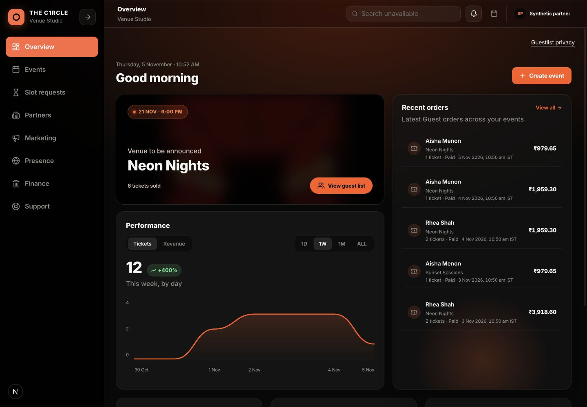

### 02-overview-tickets-graph.jpg

Overview — Tickets graph → Smooth orange curve, subtle fill, actual dated ticket counts and compact controls → 1440×1000 CSS px (detail crop) → Connected local gateway, native authentication and Firestore emulator; synthetic fixture data.

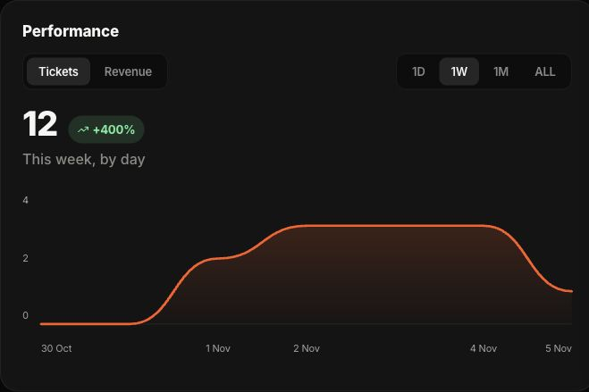

### 03-overview-revenue-graph.jpg

Overview — Revenue graph → Authoritative revenue toggle with restrained styling and actual dated values → 1440×1000 CSS px (detail crop) → Connected local gateway, native authentication and Firestore emulator; synthetic fixture data.

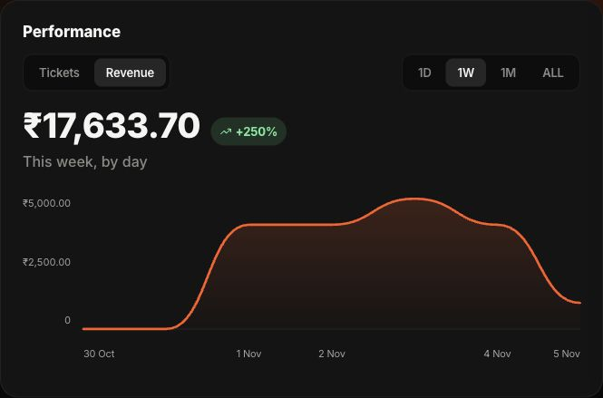

### 04-overview-recent-activity.jpg

Overview — Recent Activity / Orders → Compact connected order rows with names, event context, status, time and recorded amounts → 1440×1000 CSS px (detail crop) → Connected local gateway, native authentication and Firestore emulator; synthetic fixture data.

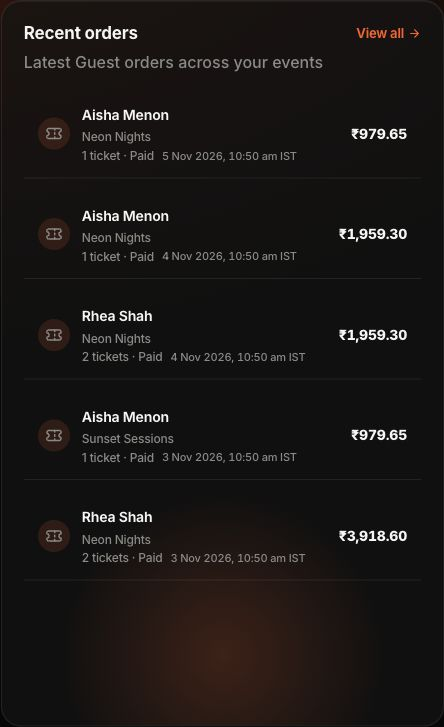

### 05-overview-desktop-continuation.jpg

Overview — full desktop view, lower section → Legitimate calendar, upcoming events and network content retained below the cleaned primary surface → 1440×1000 CSS px → Connected local gateway, native authentication and Firestore emulator; synthetic fixture data.

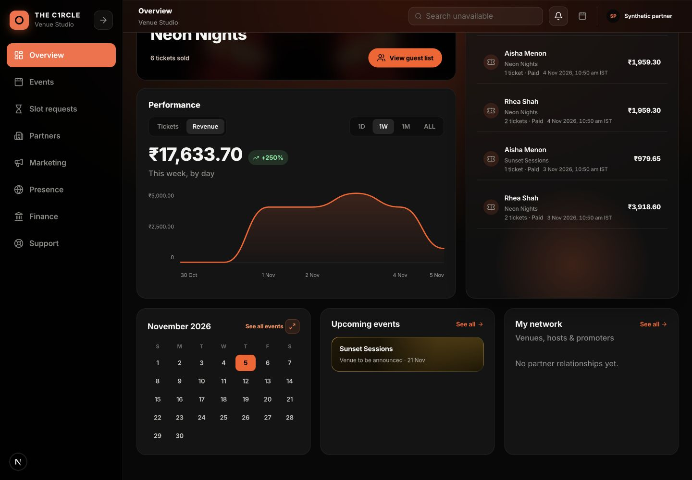

### 06-overview-laptop.jpg

Overview — laptop → Existing operational content remains usable with compact activity and chart controls at laptop width → 1280×800 CSS px → Connected local gateway, native authentication and Firestore emulator; synthetic fixture data.

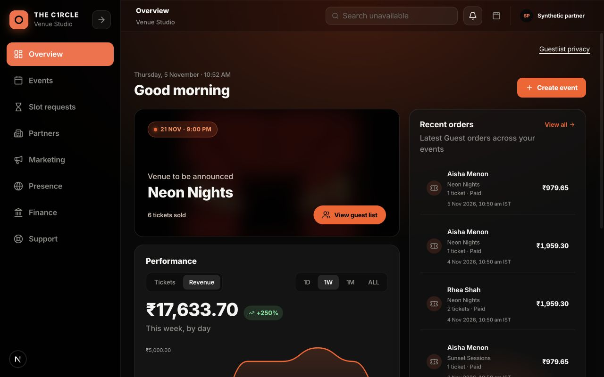

### 07-events-all-events.jpg

Events — All Events → Existing discovery, filters and event actions preserved; All Events / Analytics switch remains inside Events → 1440×1000 CSS px → Connected local gateway, native authentication and Firestore emulator; synthetic fixture data.

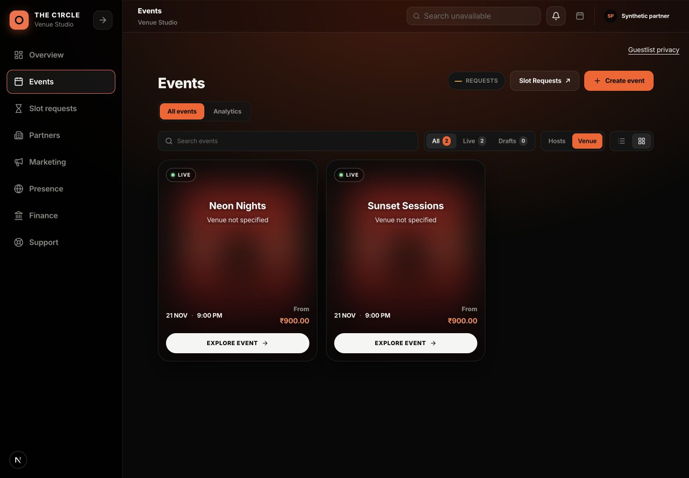

### 08-events-analytics-full-top.jpg

Events → Analytics — full view, upper section → Connected recorded totals, exact chart dates and restrained Sales over time chart → 1440×1000 CSS px → Connected local gateway, native authentication and Firestore emulator; synthetic fixture data.

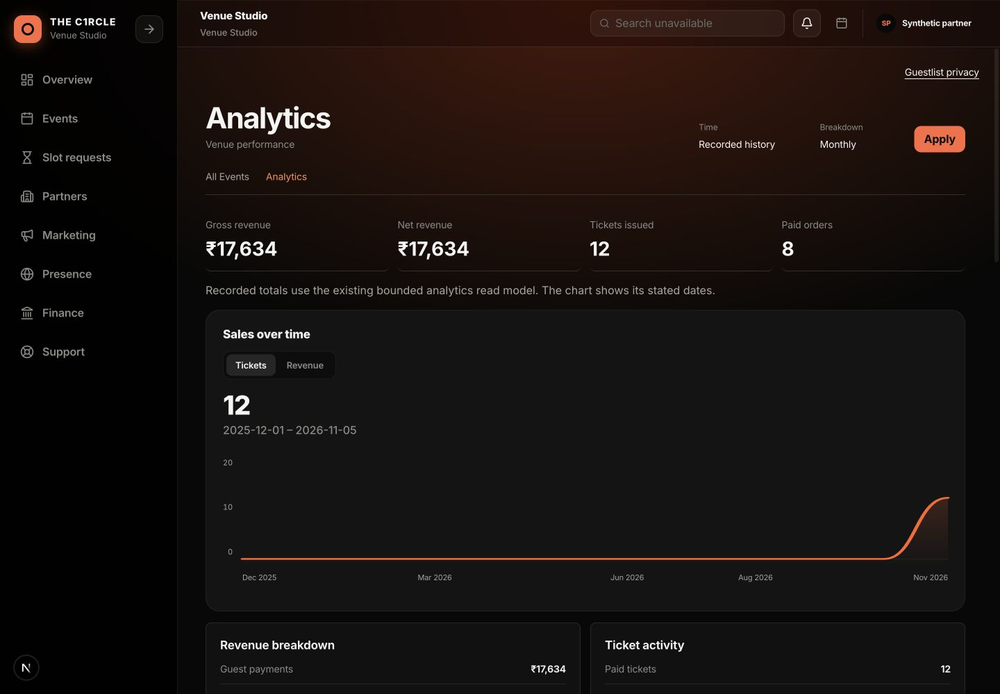

### 09-events-analytics-connected-insights.jpg

Events → Analytics — connected metrics and charts, middle section → Authoritative money/ticket breakdowns, issued units by tier, attribution and purchase timing → 1440×1000 CSS px → Connected local gateway, native authentication and Firestore emulator; synthetic fixture data.

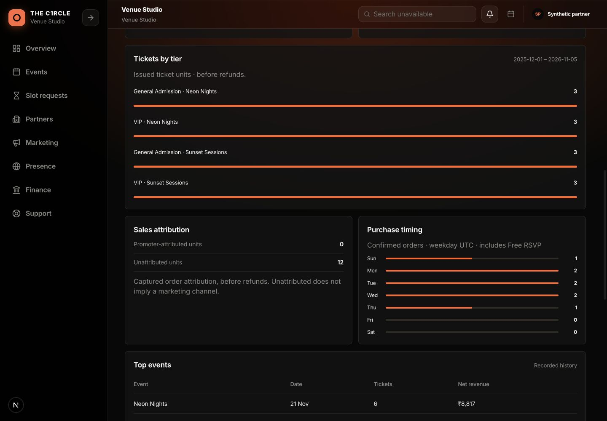

### 09a-events-analytics-breakdowns.jpg

Events Analytics — revenue and ticket activity → Captured revenue and issuance breakdowns with explicit connected source labels → 1440×1000 CSS px → Connected local gateway, native authentication and Firestore emulator; synthetic fixture data.

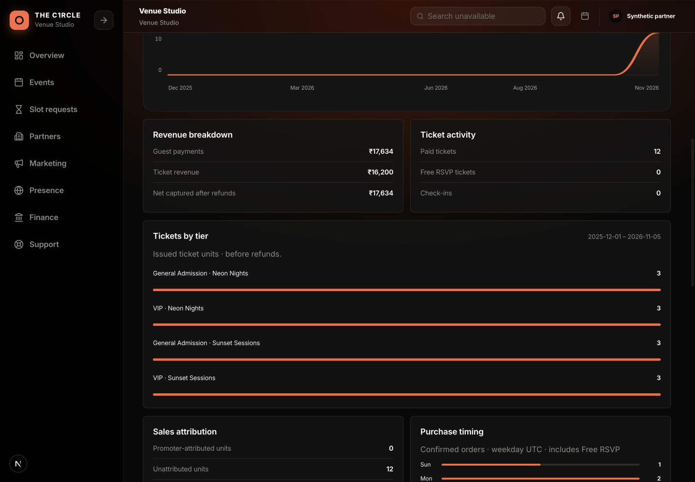

### 10-events-analytics-history.jpg

Events → Analytics — full view, lower section → Recorded event and period rows retained with source-backed values and honest zero periods → 1440×1000 CSS px → Connected local gateway, native authentication and Firestore emulator; synthetic fixture data.

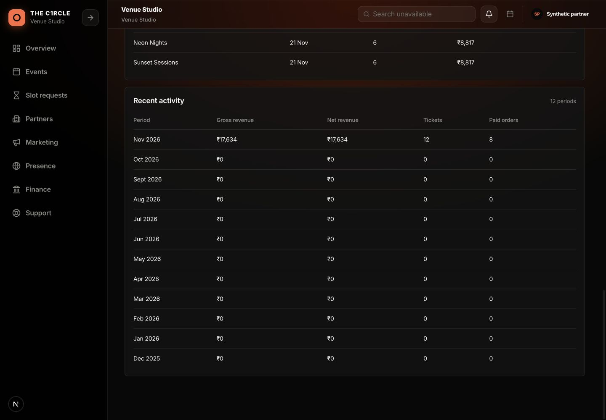

### 11-event-detail-full.jpg

Individual Event Detail — full cleaned / floating view → Artwork atmosphere, unboxed header, restrained metrics and retained operational actions → 1440×1000 CSS px → Connected local gateway, native authentication and Firestore emulator; synthetic fixture data.

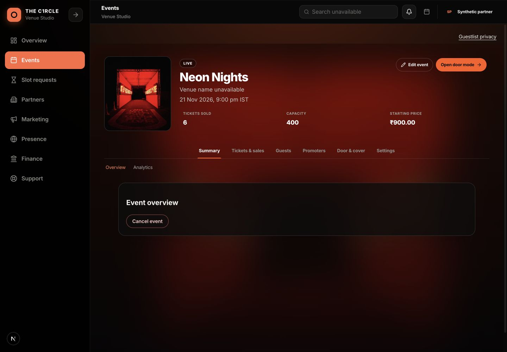

### 12-event-detail-header.jpg

Individual Event Detail — poster and header → Poster, name, date, venue context and existing Edit / Door actions arranged without a chunky card → 1440×1000 CSS px (detail crop) → Connected local gateway, native authentication and Firestore emulator; synthetic fixture data.

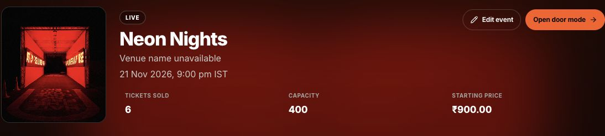

### 13-event-detail-navigation.jpg

Individual Event Detail — consolidated navigation → Six meaningful groups with contextual secondary links; underlying capabilities and routes retained → 1440×1000 CSS px (detail crop) → Connected local gateway, native authentication and Firestore emulator; synthetic fixture data.

### 14-partners-host-cards.jpg

Partners — Host cards → Vertical atmospheric card family, canonical name and descriptor, simple profile action → 1440×1000 CSS px → Connected local gateway, native authentication and Firestore emulator; synthetic fixture data.

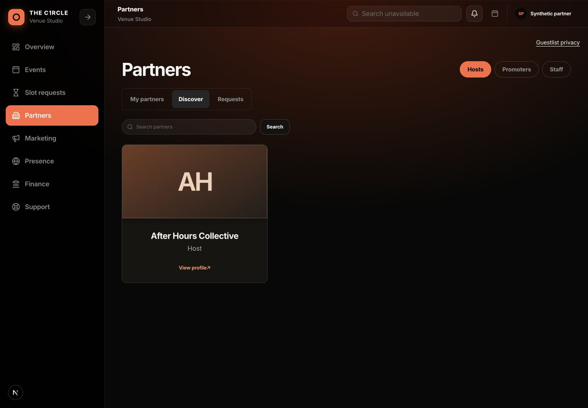

### 15-partners-promoter-cards.jpg

Partners — Promoter cards → The same restrained atmospheric family without permission or invented metadata clutter → 1440×1000 CSS px → Connected local gateway, native authentication and Firestore emulator; synthetic fixture data.

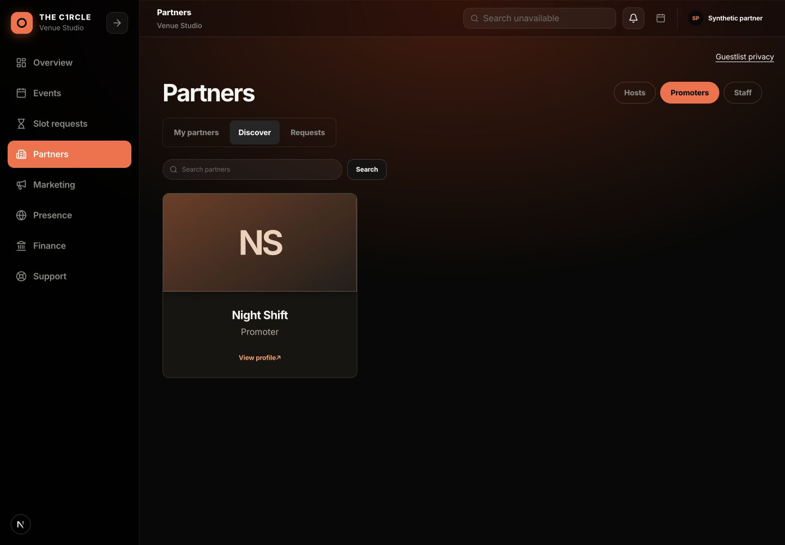

### 16-partners-staff-cards.jpg

Partners — Staff cards → Name, concise role and status with Manage access; permission pills removed from cards → 1440×1000 CSS px → Connected local gateway, native authentication and Firestore emulator; synthetic fixture data.

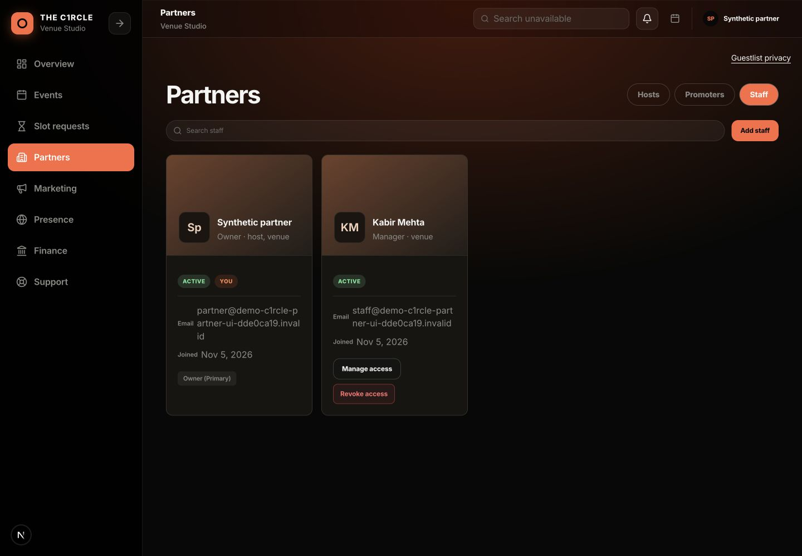

### 17-staff-manage-access.jpg

Staff → Manage Access → Available canonical access details and the existing role editor live behind Manage access instead of permission pills on cards → 1440×1000 CSS px → Connected local gateway, native authentication and Firestore emulator; synthetic fixture data.

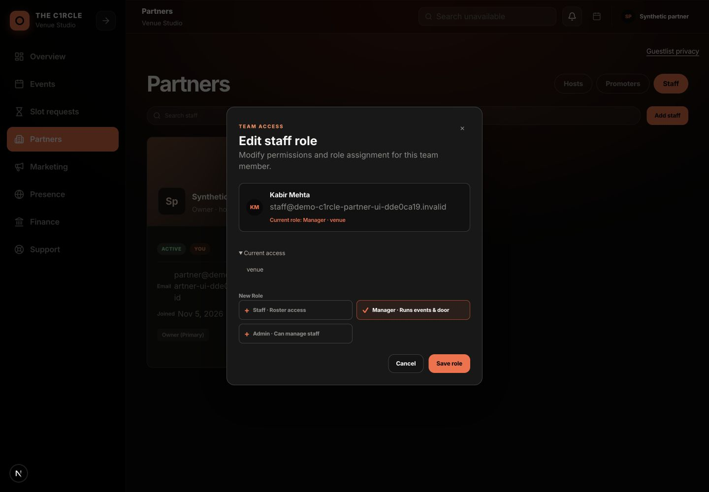

### 18-marketing-full-table.jpg

Marketing — full attendee table → Tenant-scoped current holders, canonical events, ticket units and own event spend; name-only search and clear page selection → 1440×1000 CSS px → Connected local gateway, native authentication and Firestore emulator; synthetic fixture data.

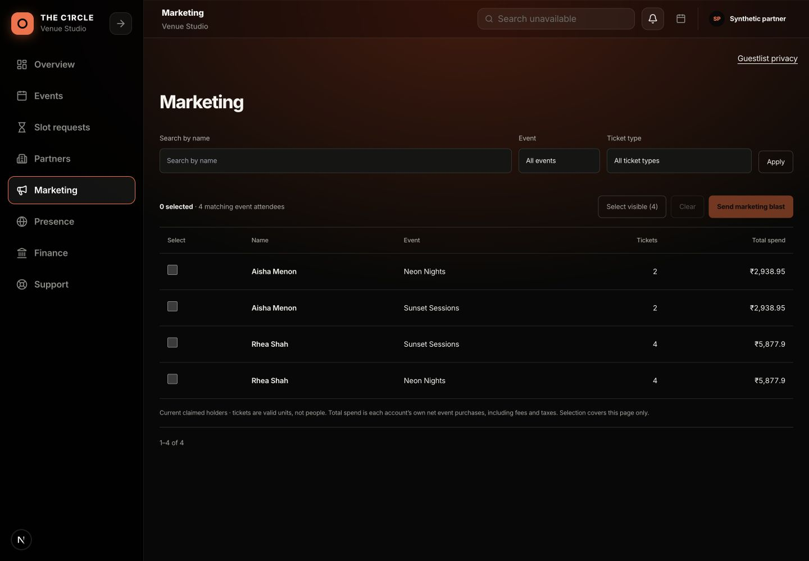

### 19-marketing-event-filter.jpg

Marketing — Event filter applied → Canonical Neon Nights filter narrows the connected audience to that event → 1440×1000 CSS px → Connected local gateway, native authentication and Firestore emulator; synthetic fixture data.

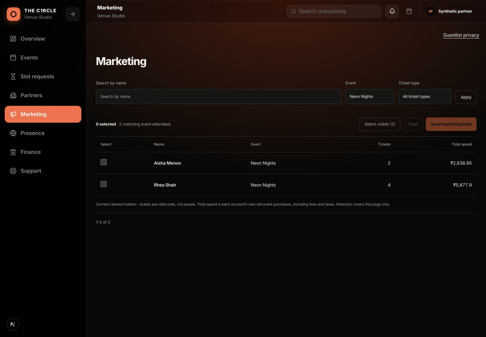

### 20-marketing-ticket-filter.jpg

Marketing — Ticket Type filter → VIP filter applied with canonical event/tier identity and cleared selection → 1440×1000 CSS px → Connected local gateway, native authentication and Firestore emulator; synthetic fixture data.

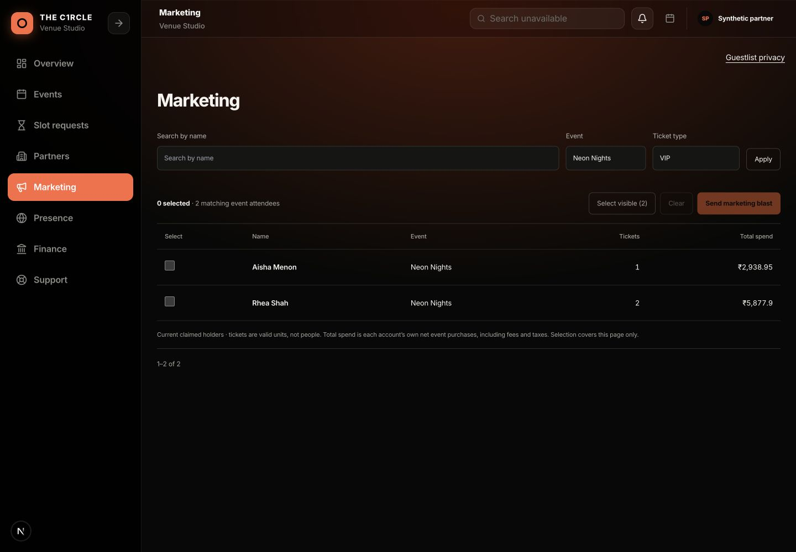

### 21-marketing-selected-attendees.jpg

Marketing — selected-attendee state → Visible-page selection, explicit selected count, clear action and enabled preview-composer entry → 1440×1000 CSS px → Connected local gateway, native authentication and Firestore emulator; synthetic fixture data.

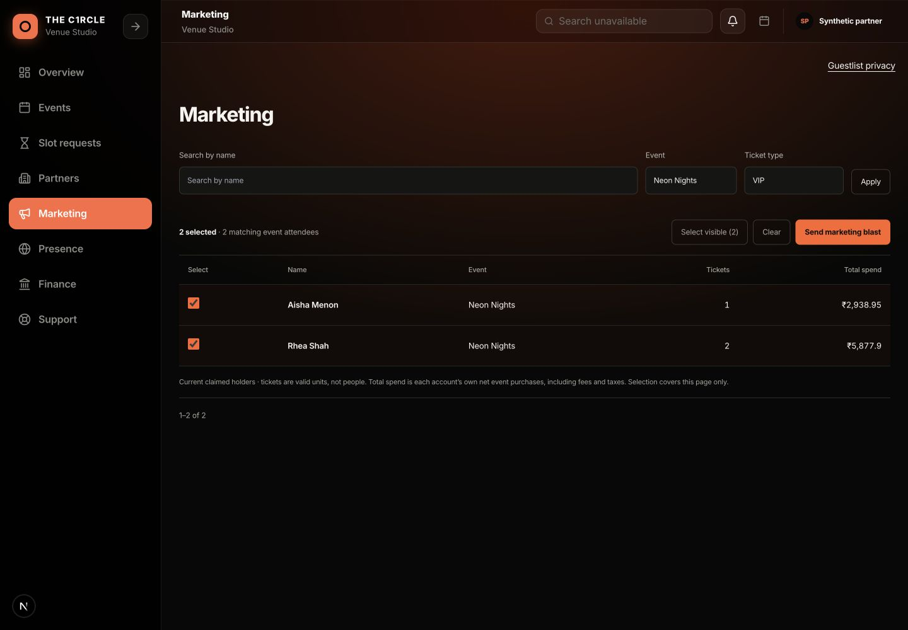

### 22-blast-whatsapp.jpg

Marketing Blast — WhatsApp preview → Local live first-name personalization, audience context, link/action and phone conversation preview → 1600×1100 CSS px → Local ephemeral preview using synthetic attendees from the connected local gateway and Firestore emulator; no delivery.

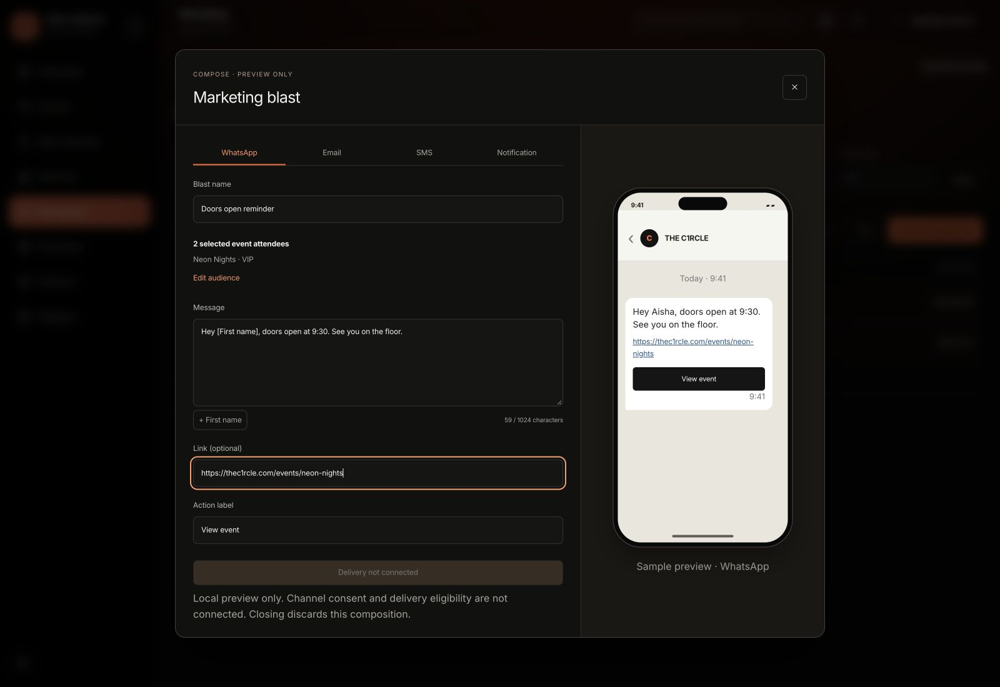

### 23-blast-sms.jpg

Marketing Blast — SMS preview → Messages-like live copy and link preview with a clear preview-only character limit → 1600×1100 CSS px → Local ephemeral preview using synthetic attendees from the connected local gateway and Firestore emulator; no delivery.

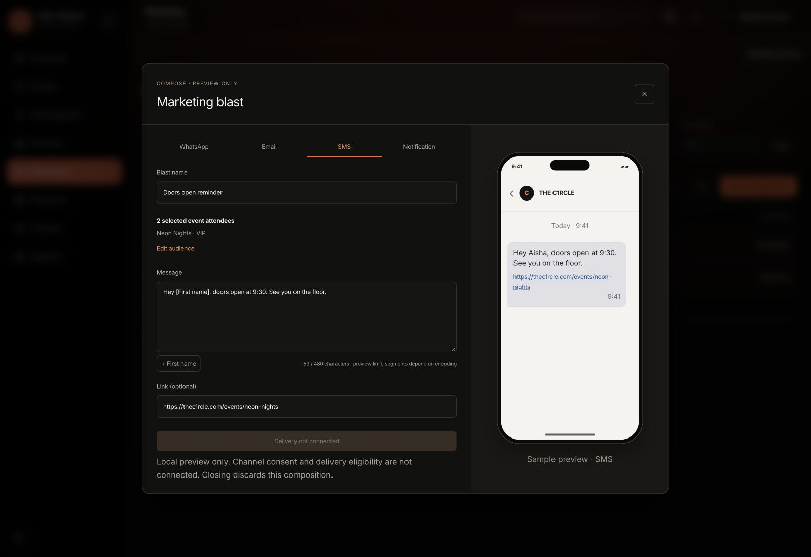

### 24-blast-email.jpg

Marketing Blast — Email preview → Subject, personalized plain text and action label update immediately in a mobile email preview → 1600×1100 CSS px → Local ephemeral preview using synthetic attendees from the connected local gateway and Firestore emulator; no delivery.

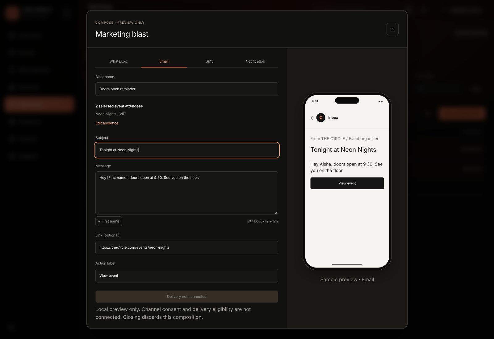

### 25-blast-notification.jpg

Marketing Blast — Notification → Channel-specific notification title and sample preview; delivery disabled → 1600×1100 CSS px → Local ephemeral preview using synthetic attendees from the connected local gateway and Firestore emulator; no delivery.

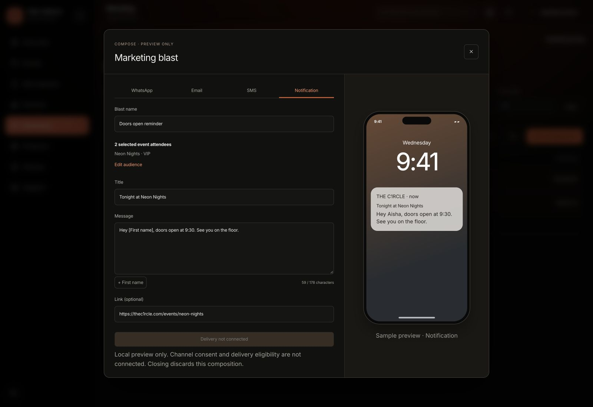

### 26-overview-mobile.jpg

Overview — mobile → Responsive metric hierarchy and preserved event content → 390×844 CSS px → Connected local gateway, native authentication and Firestore emulator; synthetic fixture data.

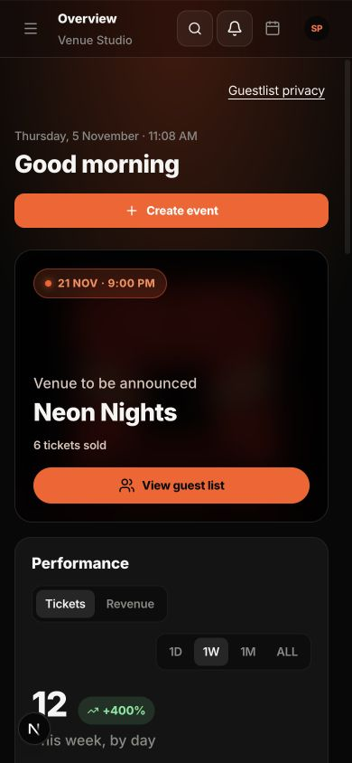

### 27-overview-mobile-graph.jpg

Overview — mobile graph/activity → Smooth responsive graph and compact real order rows → 390×844 CSS px → Connected local gateway, native authentication and Firestore emulator; synthetic fixture data.

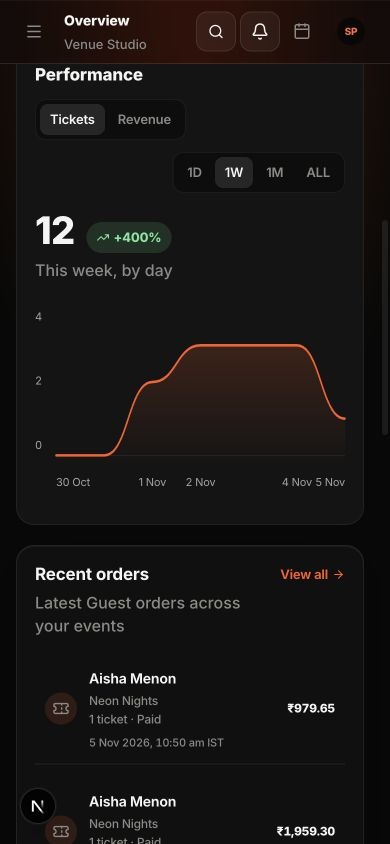

### 28-events-mobile.jpg

All Events — mobile → Compact responsive search, event tabs and retained cards → 390×844 CSS px → Connected local gateway, native authentication and Firestore emulator; synthetic fixture data.

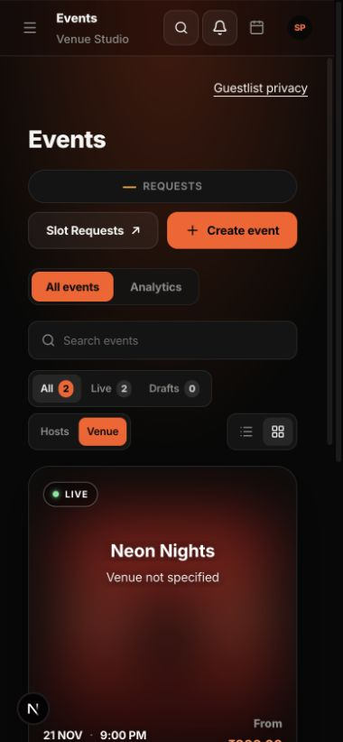

### 29-analytics-mobile.jpg

Events Analytics — mobile → Stacked connected summary, filters and graph → 390×844 CSS px → Connected local gateway, native authentication and Firestore emulator; synthetic fixture data.

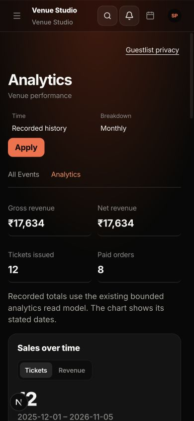

### 30-analytics-mobile-chart.jpg

Events Analytics — mobile chart → Responsive smooth chart and revenue breakdown → 390×844 CSS px → Connected local gateway, native authentication and Firestore emulator; synthetic fixture data.

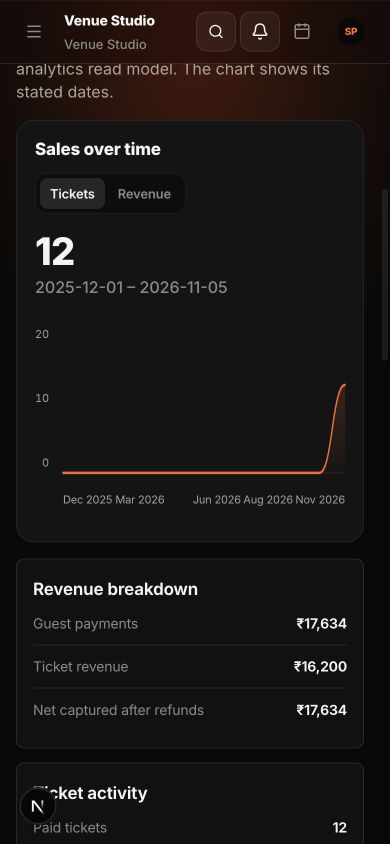

### 31-analytics-mobile-insights.jpg

Events Analytics — mobile insights → Stacked canonical tier and attribution metrics → 390×844 CSS px → Connected local gateway, native authentication and Firestore emulator; synthetic fixture data.

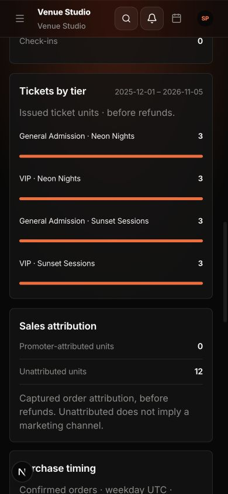

### 32-event-detail-mobile.jpg

Event Detail — mobile → Floating poster/header and consolidated navigation at phone width → 390×844 CSS px → Connected local gateway, native authentication and Firestore emulator; synthetic fixture data.

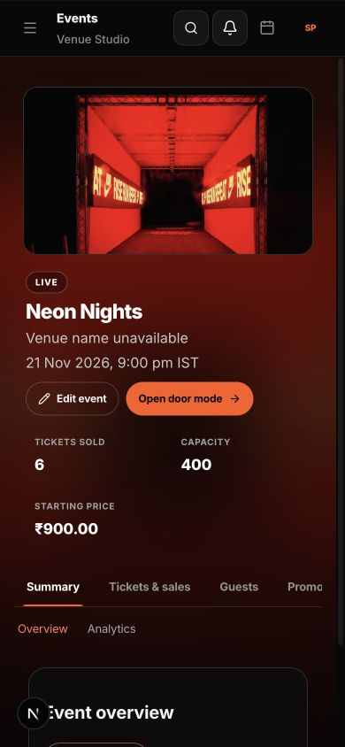

### 33-host-cards-mobile.jpg

Partners — Host cards mobile → Vertical atmospheric partner cards with honest initials fallback → 390×844 CSS px → Connected local gateway, native authentication and Firestore emulator; synthetic fixture data.

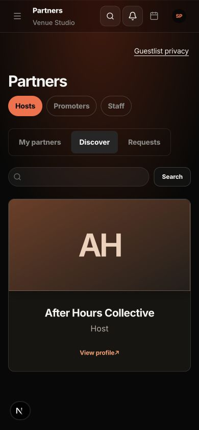

### 34-staff-cards-mobile.jpg

Partners — Staff mobile → Role/status cards without permission pill clutter → 390×844 CSS px → Connected local gateway, native authentication and Firestore emulator; synthetic fixture data.

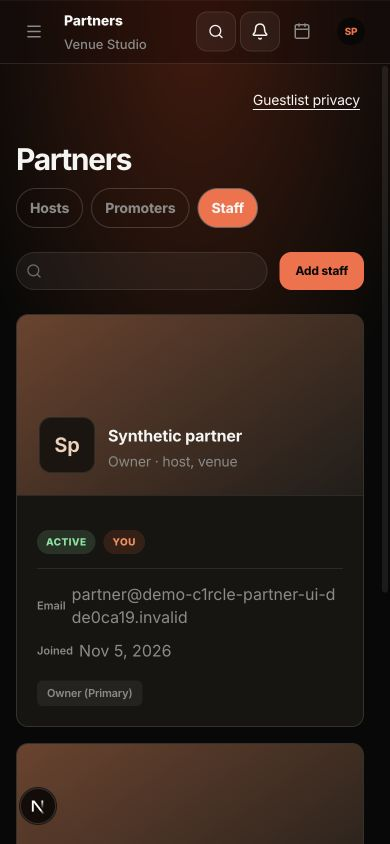

### 35-staff-mobile-manage-button.jpg

Staff — mobile continuation → Manager card exposes Manage access without permission pills → 390×844 CSS px → Connected local gateway, native authentication and Firestore emulator; synthetic fixture data.

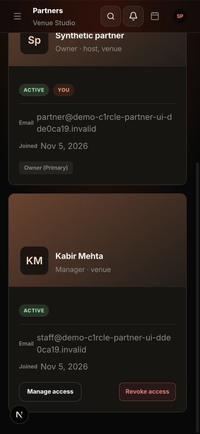

### 36-manage-access-mobile.jpg

Staff Manage Access — mobile → Existing role editor and available capability details retained in dialog → 390×844 CSS px → Connected local gateway, native authentication and Firestore emulator; synthetic fixture data.

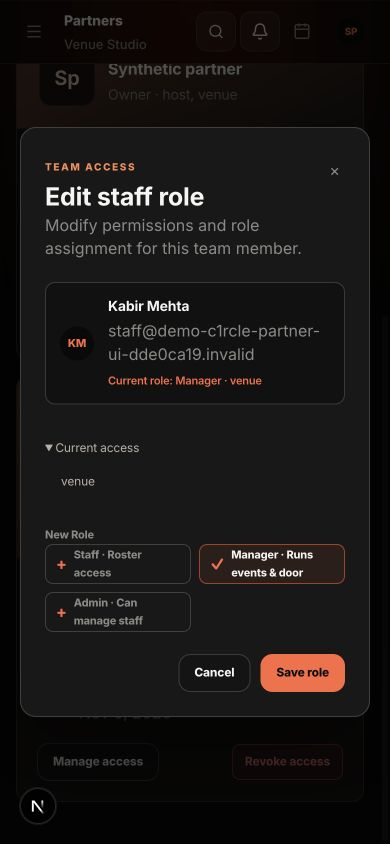

### 37-marketing-mobile.jpg

Marketing — mobile → Stacked filters and horizontally scrollable authorized table → 390×844 CSS px → Connected local gateway, native authentication and Firestore emulator; synthetic fixture data.

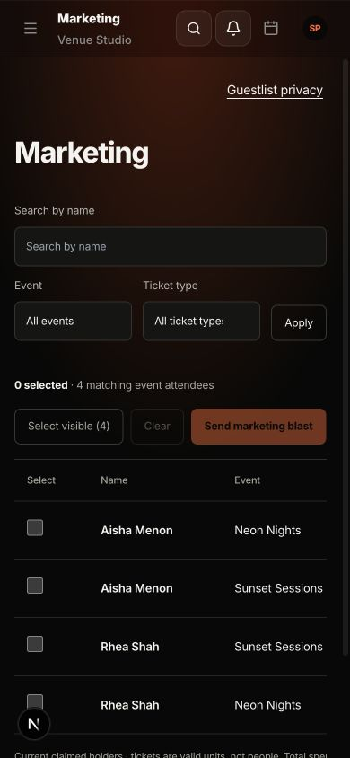

### 38-marketing-mobile-table-right.jpg

Marketing — mobile table continuation → Native table horizontal scroll exposes ticket units and own-event spend → 390×844 CSS px → Connected local gateway, native authentication and Firestore emulator; synthetic fixture data.

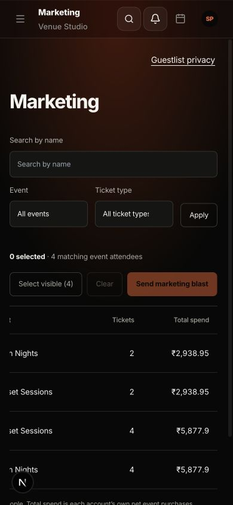

### 39-blast-mobile-editor.jpg

Marketing Blast — mobile editor → Stacked ephemeral composer with selected audience context → 390×844 CSS px → Local ephemeral preview using synthetic attendees from the connected local gateway and Firestore emulator; no delivery.

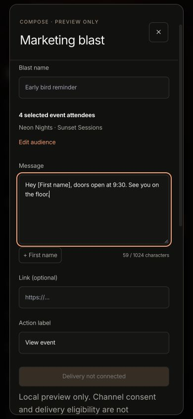

### 39a-blast-mobile-channels.jpg

Marketing Blast — mobile channel controls → Four-channel controls and audience remain usable in stacked dialog → 390×844 CSS px → Local ephemeral preview using synthetic attendees from the connected local gateway and Firestore emulator; no delivery.

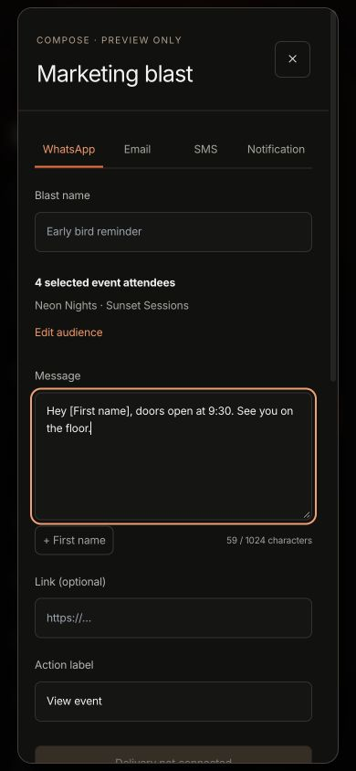

### 40-blast-mobile-preview.jpg

Marketing Blast — mobile phone preview → Below-fold phone preview renders substituted sample name without sending → 390×844 CSS px → Local ephemeral preview using synthetic attendees from the connected local gateway and Firestore emulator; no delivery.

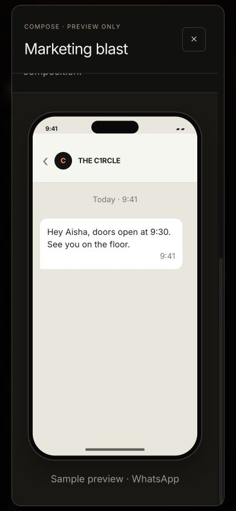
